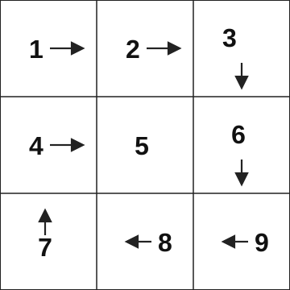
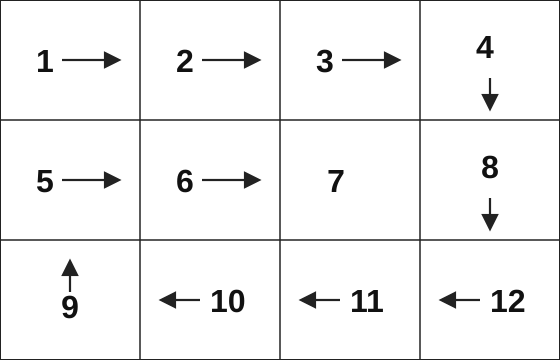

# Coding challenge — spiral order

Given a two-dimensional matrix, return every element in clockwise spiral order. Use any programming language, or pseudocode if you prefer not to write runnable code.

This is the spiral-matrix problem (LeetCode 54).

## The change

Start at the top-left cell. Walk right along the top row, down the right column, left along the bottom row, and up the left column. Then repeat on the inner cells that are still unvisited, until every cell has been visited once.

Return the elements in the order you visit them. Leave the matrix unchanged.

### Example 1

**Input:** `matrix = [[1, 2, 3], [4, 5, 6], [7, 8, 9]]`

**Output:** `[1, 2, 3, 6, 9, 8, 7, 4, 5]`

### Example 2

**Input:** `matrix = [[1, 2, 3, 4], [5, 6, 7, 8], [9, 10, 11, 12]]`

**Output:** `[1, 2, 3, 4, 8, 12, 11, 10, 9, 5, 6, 7]`

## Cases

| Input | Expected result |
|---|---|
| `[[1, 2, 3], [4, 5, 6], [7, 8, 9]]` | `[1, 2, 3, 6, 9, 8, 7, 4, 5]` |
| `[[1, 2, 3, 4], [5, 6, 7, 8], [9, 10, 11, 12]]` | `[1, 2, 3, 4, 8, 12, 11, 10, 9, 5, 6, 7]` |
| `[[1, 2, 3, 4]]` | `[1, 2, 3, 4]` |
| `[[1], [2], [3]]` | `[1, 2, 3]` |
| `[[7]]` | `[7]` |
| `[]` | `[]` |

## What to hand back

1. The code or pseudocode that produces the spiral order.
2. Two or three sentences on why you chose that approach, including how you stop so a cell is not visited twice.
3. The result of each case above.
