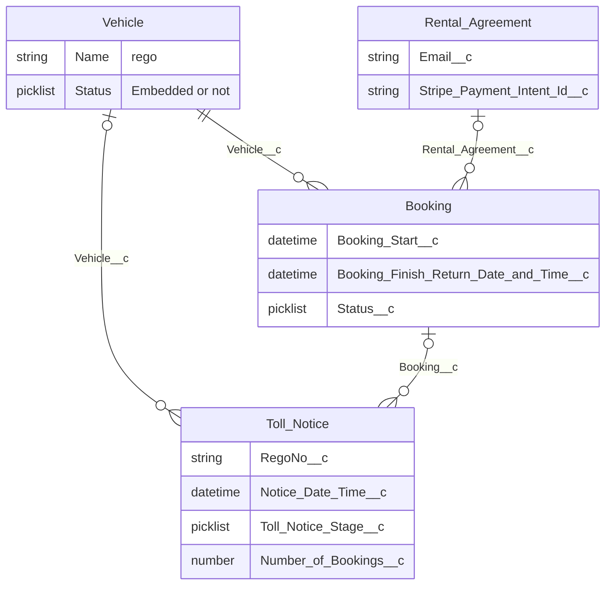

A toll notice points at one vehicle and one booking. Both links are optional. A vehicle and a booking can each have many notices. A booking points at one rental agreement, and one agreement can cover many bookings.

The notice is matched by rego and trip time. `RegoNo__c` is compared to `Vehicle.Name`. A booking on that vehicle counts when it has started by the trip time, has not finished or has no finish time, and is not Cancelled or Scheduled. One match is stored on `Booking__c` and the stage becomes `Assigned`. `Number_of_Bookings__c` keeps the count when more than one booking covers the trip.

The rental agreement is a `Form_Submission__c` with record type Rental Agreement. `Booking.Rental_Agreement__c` stores it. The hirer email and the Stripe payment intent used for a toll charge sit on that agreement.

## New requirement

### Problem

From July 2026, Carbiz can no longer nominate customers for NSW tolls and, as the registered vehicle owner, must pay the toll provider directly. Toll information will now arrive digitally rather than through the existing paper-based process, but Carbiz does not yet have a controlled way to import the data, match each toll to the correct hire, recover the cost from the customer, manage exceptions, or give Accounts Payable an accurate record of the liability. This creates manual effort, delayed payments, incorrect or duplicate charging risk, and financial leakage.

### Desired outcome

Every NSW toll received digitally is recorded, matched and actioned within the required timeframe. Clear customer-incurred tolls are charged to the authorised payment method, customers receive the appropriate receipt or payment request, exceptions are visible for follow-up, and Finance can separately record, pay and reconcile the amount Carbiz owes the toll provider.
