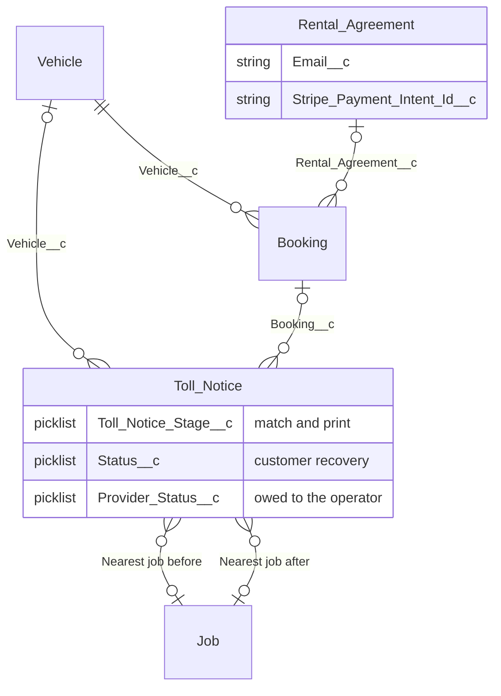

# Solution 1: Toll payment fields on Toll Notice

Toll Notice is the only toll record. Every Toll Payment field moves onto it. The payment object, the mirror lookup, and `Toll_Notice_Key__c` go away, because the notice is already one row per toll.

The notice still points at one vehicle and one booking. The booking still points at one rental agreement. Customer email and the saved-card payment intent stay on that agreement and are read through the booking.

Three statuses live on the one notice. They answer different questions and move on their own.

| Field | Question | Values |
|---|---|---|
| `Toll_Notice_Stage__c` | Has it been matched, and where is the paper pack? | Unassigned, Assigned, Ready to Print, Printed, Paid |
| `Status__c` | Has the customer paid Carbiz? | Our cost, Awaiting charge, Charging, Unrecovered, Recovered, Unrecoverable, Disputed, Refunded |
| `Provider_Status__c` | Has Carbiz paid the toll operator? Starts at Owed. | Owed, Paid, Not ours |

`Assigned` sets `Status__c` to Awaiting charge. Any other stage sets it to Our cost. Once the status has moved past those two, a later stage change leaves it alone. `Amount__c` follows `TollAmount__c` until a charge claim or a Stripe id exists, then the charged amount stays put.

## Fields added to Toll Notice

**Customer recovery.** `Status__c`, `Amount__c`, `Method__c` (Stored card, Payment link, Manual), `Failure_Reason__c`, `Last_Charge_Attempt__c`, `Has_Card_on_File__c`, `Next_Action__c`, `Charge_Claim_Key__c`.

**Holds.** `Hold_Reasons__c`, `Hold_Pauses__c` (Recovery only, Payment too), `Held_Since__c`, `Hold_Resolution__c`, `Resolution_Note__c`, `Confirmed_Reasons__c`, `Confirmed_At__c`, `Recorded_By__c`. `Days_Held__c` is the formula from `Held_Since__c`.

**Stripe charge.** `Stripe_Payment_Intent_Id__c`, `Stripe_Invoice_Id__c`, `Stripe_Fee__c`, `Stripe_Net__c`, `Card_Update_Sent_At__c`, `Receipt_Sent_At__c`.

**Customer invoice.** `Invoice_Company__c`, `Invoice_ABN__c`, `Invoice_Admin_Fee__c`, `Invoice_Claim_Key__c`, `Invoice_Number__c`, `Invoice_Url__c`, `Invoice_Due_Date__c`, `Invoiced_At__c`, `Is_Invoice_Sent__c`. `Invoice_Days_Until_Due__c` and `Net_Recovered__c` stay as formulas.

**What Carbiz owes the operator.** `Provider_Status__c`, `Provider_Paid_Date__c`, `Provider_Confirmation__c`. These are the Accounts Payable record. The notice already has `Date_Paid__c` and `Confirmation_Number__c` for the paper process. The new process writes the provider fields.

**Refund, dispute, and close.** `Refund_Amount__c`, `Refund_Reason__c`, `Refund_Note__c`, `Refund_Reference__c`, `Dispute_Amount__c`, `Dispute_Reason__c`, `Dispute_Note__c`, `Dispute_Reference__c`, `Closure_Reason__c`, `Closure_Note__c`.

**Match context.** `Nearest_Job_Before__c`, `Nearest_Job_After__c`.

**Formulas, now local.** `Customer_Email__c` and `Rental_Stripe_Payment_Intent_Id__c` come from the booking's rental agreement. `Stripe_Customer_Id__c` comes from the booking. `Face_Amount__c` is no longer needed, because `TollAmount__c` is already on the notice. `Arrived_On__c` is `CreatedDate`.

The import writes the scan only: notice number, rego, trip time, toll amount, company, and state. It does not write status, amount, holds, or Stripe ids. Refunded and Unrecoverable stay behind the same permissions they have today.

## Benefit

One toll is one record, so matching, charging the customer, and paying the operator are visible together. That is the July 2026 outcome: a digital toll is recorded, a clear customer toll is charged from the rental agreement's card, a hold is the exception list, and Finance filters `Provider_Status__c = Owed` to see what Carbiz still owes the operator.

There is no second object to create, no mirror to keep in step, and no join for the toll report. A matched notice can move to Awaiting charge in the same save that sets the booking. Accounts Payable and the tolls team work from the same row, with the operator debt kept separate from what the customer has paid.
