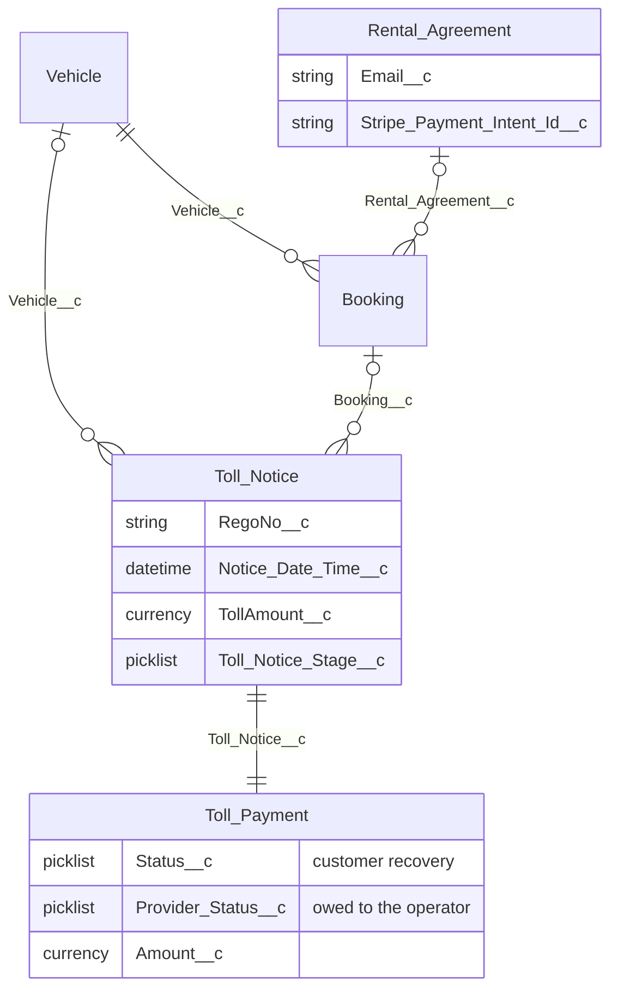

# Solution 2: Toll Payment object

Toll Notice stays the scanned toll and the match to a vehicle and a booking. Toll Payment is a new object, one per notice, and it is where the money is kept.

The payment lookup to the notice is required. `Toll_Notice_Key__c` stores that notice Id and is unique, so a notice can have only one payment. The notice looks back at its payment so the page can show the money record.

## What each record owns

**Toll Notice** is the digital reading and the match. It keeps the notice number, rego, trip time, face amount, company, and state. `Toll_Notice_Automation` matches it to a vehicle by rego and to a booking that covers the trip time. Stage stays the match and print path: Unassigned, Assigned, Ready to Print, Printed, Paid.

**Toll Payment** is created with the notice. It starts at customer status `Our cost` and provider status `Owed`. When the notice becomes `Assigned`, the payment moves to `Awaiting charge`. After a charge has started, a later stage change leaves the customer status as it is.

Customer status and provider status answer different questions.

| Field | Question | Values |
|---|---|---|
| `Status__c` | Has the customer paid Carbiz? | Our cost, Awaiting charge, Charging, Unrecovered, Recovered, Unrecoverable, Disputed, Refunded |
| `Provider_Status__c` | Has Carbiz paid the toll operator? | Owed, Paid, Not ours |

`Amount__c` starts as the notice toll amount. It keeps following that amount until a charge claim or a Stripe id is stored, and then it stays at the amount that was charged.

The charge uses the booking's rental agreement. Customer email and the saved-card payment intent are read from that agreement. The invoice supplier follows the booking: a hire with a provider is Carbiz Rentals Australia, and any other hire is FPND trading as Carbiz Rentals.

## Fields on Toll Payment

**Customer recovery.** `Status__c`, `Amount__c`, `Method__c` (Stored card, Payment link, Manual), `Failure_Reason__c`, `Last_Charge_Attempt__c`, `Has_Card_on_File__c`, `Next_Action__c`, `Charge_Claim_Key__c`.

**Holds, the exception list.** `Hold_Reasons__c`, `Hold_Pauses__c` (Recovery only, or Payment too), `Held_Since__c`, `Days_Held__c`, `Hold_Resolution__c`, `Resolution_Note__c`, `Confirmed_Reasons__c`, `Confirmed_At__c`, `Recorded_By__c`. A hold pauses the customer charge. `Payment too` also pauses paying the operator.

**Stripe and the customer invoice.** `Stripe_Payment_Intent_Id__c`, `Stripe_Invoice_Id__c`, `Stripe_Fee__c`, `Stripe_Net__c`, `Card_Update_Sent_At__c`, `Receipt_Sent_At__c`, `Invoice_Company__c`, `Invoice_ABN__c`, `Invoice_Admin_Fee__c`, `Invoice_Claim_Key__c`, `Invoice_Number__c`, `Invoice_Url__c`, `Invoice_Due_Date__c`, `Invoiced_At__c`, `Is_Invoice_Sent__c`, `Invoice_Days_Until_Due__c`, `Net_Recovered__c`.

**What Carbiz owes the operator.** `Provider_Status__c`, `Provider_Paid_Date__c`, `Provider_Confirmation__c`.

**Refund, dispute, and close.** `Refund_Amount__c`, `Refund_Reason__c`, `Refund_Note__c`, `Refund_Reference__c`, `Dispute_Amount__c`, `Dispute_Reason__c`, `Dispute_Note__c`, `Dispute_Reference__c`, `Closure_Reason__c`, `Closure_Note__c`.

**Match context.** `Nearest_Job_Before__c`, `Nearest_Job_After__c`. `Customer_Email__c`, `Stripe_Customer_Id__c`, and `Rental_Stripe_Payment_Intent_Id__c` are formulas through the notice's booking and rental agreement. `Face_Amount__c` is the notice toll amount.

The import writes the notice. It records the scan even when the reading needs review. The payment carries the hold. Refunded and Unrecoverable stay behind their own permissions.

## How a digital toll moves

1. The toll arrives and a Toll Notice is saved. A Toll Payment is created at `Our cost` and `Owed`.
2. The notice is matched to the vehicle and the booking. A single covering booking sets the stage to `Assigned`, and the payment moves to `Awaiting charge`.
3. A clear toll is charged to the card on the rental agreement. The customer receives a receipt, or an invoice when the card cannot be charged. Status becomes `Recovered` or `Unrecovered`.
4. A hold leaves the toll visible for follow-up. Releasing the last hold on a matched toll returns it to `Awaiting charge`. A resolution of Carbiz cost or Waived returns it to `Our cost`.
5. Finance pays the operator from `Provider_Status__c = Owed`, then sets `Paid` with the paid date and the provider confirmation.

## Benefit

Each digital toll has one notice and one payment. The notice is the record of what arrived and which hire it belongs to. The payment is the record of the customer charge, the exception, and the amount Carbiz owes the toll operator.

Accounts Payable works from provider status, paid date, and confirmation. The tolls team works from customer status and holds. A receipt or a payment request is sent from the same payment that stores the Stripe charge and the invoice. Finance can list what is still owed to the operator, and what has been recovered from the customer, on every toll.
